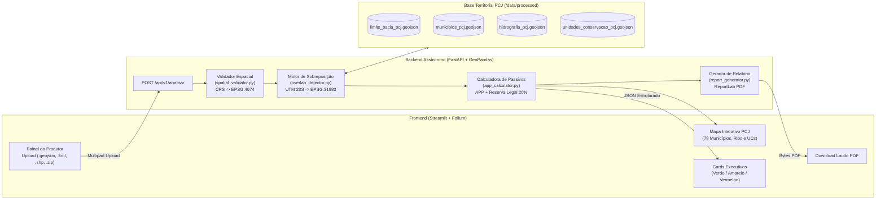

# civis-agricola
Orientação para Licenciamento, Conformidade e Benefícios para o Pequeno Produtor Rural.

# 🌱 Civis Agricola — Consultoria Ambiental Rural (Bacias PCJ)


-139C5A)


> **Orientação para Licenciamento, Conformidade e Benefícios para o Pequeno Produtor Rural.**

O **Civis Agricola** (*cidadão agricultor*, em latim) é uma aplicação web geoespacial de código aberto voltada ao pré-diagnóstico ambiental de propriedades rurais inseridas nas **Bacias Hidrográficas dos Rios Piracicaba, Capivari e Jundiaí (Bacias PCJ)**. Desenvolvido sob diretrizes de *Citizen Tech* e extensão rural, o sistema traduz análises topológicas complexas em orientações acessíveis (no estilo de cartilhas técnicas da Embrapa e do Sebrae) para apoiar a adequação ao **Código Florestal Brasileiro (Lei Federal nº 12.651/2012)**, a validação do **Cadastro Ambiental Rural (CAR)**, o planejamento do **Programa de Regularização Ambiental (PRA)** e o acesso a linhas de crédito rural sustentável (como o Pronaf).

## 🎯 Motivação e Escolha das Bacias PCJ

Pequenos produtores e agricultores familiares frequentemente enfrentam barreiras técnicas e financeiras para interpretar exigências de licenciamento ambiental, faixas de proteção hídrica e restrições de uso do solo.

O recorte territorial das **Bacias PCJ (UGRHI-05 em São Paulo e bacias afluentes em Minas Gerais)** foi escolhido por sua relevância crítica:
* **Abrangência Regional:** Engloba 78 municípios (73 em SP e 5 em MG) em um dos maiores polos agroindustriais e econômicos do país.
* **Segurança Hídrica Estratégica:** Abastece milhões de habitantes e integra o Sistema Cantareira, tornando a conservação de nascentes e matas ciliares prioritária para políticas públicas e programas de Pagamento por Serviços Ambientais (PSA).
* **Mosaico de Áreas Protegidas:** A coexistência entre produção agrícola e Unidades de Conservação (como a APA Tanquã, a Estação Ecológica de Ibicatu e a APA do Sistema Cantareira) exige verificação espacial precisa para evitar autuações e passivos ambientais.

## 🏗️ Arquitetura do Sistema

A aplicação adota uma arquitetura modular desacoplada 100% construída em tecnologias livres, operando sob o sistema geodésico oficial **SIRGAS 2000 (EPSG:4674)** para persistência vetorial e **SIRGAS 2000 / UTM Zona 23S (EPSG:31983)** para cálculos métricos de área e geração de *buffers* de Área de Preservação Permanente (APP).



## 📂 Estrutura de Diretórios

```text
civis-agricola/
├── .streamlit/
│   └── config.toml                        # Configuração de tema escuro de alto contraste
├── backend/
│   ├── __init__.py
│   ├── spatial_validator.py               # Validação topológica 2D e reprojeção SIRGAS 2000
│   ├── overlap_detector.py                # Cruzamento espacial com hidrografia e UCs da Bacia PCJ
│   ├── app_calculator.py                  # Cálculo de APP, Reserva Legal (20%) e diretrizes técnicas
│   ├── report_generator.py                # Emissão de laudo diagnóstico em PDF (ReportLab)
│   ├── main.py                            # Servidor FastAPI e endpoint POST /api/v1/analisar
│   └── test_backend.py                    # Suíte de testes unitários multi-município
├── data/
│   └── processed/                         # Camadas vetoriais oficiais padronizadas em EPSG:4674
│       ├── limite_bacia_pcj.geojson
│       ├── municipios_pcj.geojson
│       ├── hidrografia_pcj.geojson
│       ├── unidades_conservacao_pcj.geojson
│       └── samples_pcj/                   # Polígonos de teste (Piracicaba, Jundiaí e Limeira)
├── frontend/
│   └── app.py                             # Interface Streamlit, mapa Folium e exportação de laudo
├── notebooks/
│   └── prepare_pcj_data.py                # Pipeline de coleta via API IBGE e padronização cartográfica
├── .containerignore                       # Regras de exclusão para build OCI/Podman
├── Containerfile                          # Definição de imagem Linux com GDAL/PROJ/GEOS livres
├── compose.yaml                           # Orquestração rootless de containers (Backend + Frontend)
├── requirements.txt                       # Dependências Python congeladas
└── LICENSE                                # Licença livre GNU AGPLv3
```

## 🚀 Como Executar o Projeto

### Opção 1: Via Podman / Containers OCI (Recomendado — 100% Software Livre)

Com o **Podman** e o **podman-compose** instalados, suba todo o ecossistema com um único comando na raiz do projeto:

```bash
podman compose up --build
```

* **Painel Interativo (Streamlit):** acesse `http://localhost:8501`
* **Documentação Interativa da API (Swagger UI):** acesse `http://localhost:8000/docs`

### Opção 2: Execução Local com Ambiente Virtual Python (`venv`)

1. Clone o repositório e acesse o diretório:
```powershell
git clone [https://github.com/FelipePaullelli/civis-agricola.git](https://github.com/FelipePaullelli/civis-agricola.git)
cd civis-agricola
```

2. Crie e ative o ambiente virtual:
```powershell
python -m venv .venv
.\.venv\Scripts\Activate.ps1
```

3. Instale as dependências:
```powershell
pip install -r requirements.txt
```

4. Inicie o painel interativo (o frontend conta com *fallback* inteligente para o motor local caso a API HTTP não esteja aberta em outro terminal):
```powershell
streamlit run frontend/app.py
```

*(Opcional) Para rodar o servidor FastAPI separadamente em outro terminal:*
```powershell
uvicorn backend.main:app --reload --port 8000
```

## 🧪 Testes Automatizados e Cenários de Validação

O repositório inclui uma bateria de testes automatizados que valida três cenários representativos das Bacias PCJ, além do bloqueio de geometrias abertas ou inválidas (HTTP 422):
1. **Piracicaba (`piracicaba_uc_app.geojson`):** Propriedade com interseção simultânea em faixa de APP do Rio Piracicaba e na Unidade de Conservação APA Tanquã.
2. **Jundiaí (`jundiai_app.geojson`):** Propriedade interceptada por faixa de APP do Rio Jundiaí, sem restrições de Unidades de Conservação.
3. **Limeira (`limeira_regular.geojson`):** Propriedade sem sobreposição com cursos d'água principais ou Unidades de Conservação mapeadas.

Para executar a suíte de validação do backend e do frontend via terminal:

```powershell
python backend/test_backend.py
python frontend/app.py --check
```

## 📜 Licença

Distribuído sob a licença **GNU Affero General Public License v3.0 (AGPL-3.0)**. Consulte o arquivo `LICENSE` para mais detalhes.
